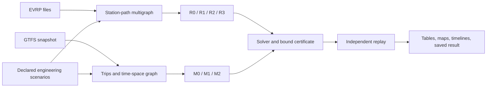

# Design

This design links EV routing and transit vehicle blocking through one question: what do range
and charging constraints add to the cost of serving the same demand, and how tightly is that
increment bounded?

**1. Decision**

Build **Electric-Fleet-Model**: exact models for electric-vehicle routing and
electric-bus scheduling with charging, each solved with a bound attached. Two
applications share one certificate core.

| Track | Data | Question |
| --- | --- | --- |
| Routing, R0-R3 ([Routing](ROUTING.md)) | CEC-2020 EVRP benchmark, as distributed by evrp-python | Are the published values optimal, and what do battery range and charging physics cost? |
| Transit, M0-M4 ([Models](MODELS.md)) | TransLink's public GTFS timetable | Which buses and chargers can operate a published timetable, at what cost? |

The central question of both is: **what do the battery and charging constraints
cost, relative to the same fleet without them, and can the answer be certified?**
In routing it is z(R1)-z(R0); in transit, M1 against M0, and M2 against M1.

For the transit case, given mandatory passenger trips, candidate buses, candidate
charging locations, and electricity prices, determine:

1. Which buses operate, and which trips each bus serves.
2. Where buses travel empty, wait, and charge between trips.
3. How many charging plugs are required and which candidate sites open.
4. Charging power, state of charge, grid demand, and total modeled cost.
5. A feasible upper bound, an independently justified lower bound, and the gap.

This is an architectural design. The user asked for the complete design now and
implementation later, authorized choosing the application on mathematical
strength and data access, and then named evrp-python as a further reference.
Numerical parameters below are design choices, not agency facts.

**2. Why these applications**

The following comparison is a design judgment, not a measured ranking.

| Candidate | Accessible inputs | Role of nonlinear optimization | Main limitation | Decision |
| --- | --- | --- | --- | --- |
| Electric vehicle routing, CEC-2020 benchmark | 41 instance files in two sets; published upper bounds from the report and from several heuristics | Partial recharging with resistive loss is a convex MINLP (R3) | Synthetic instances in abstract units; no time or price data | Selected: external values to certify against |
| Electric transit scheduling and charging | Official timetables, stops, shapes, sometimes blocks | Sparse charging NLP/QP subproblems recur in integer scheduling and capacity planning | Energy, depot, and charger parameters need explicit assumptions | Selected: real service data |
| Electric last-mile delivery, Amazon routes | Amazon historical routes | Charging, speed, and energy interact with routing | Noncommercial license; matrices within historical routes; EV parameters absent | Not selected |
| Nonlinear-charging EVRP (Montoya instances) | VRP-REP 2016-0020 | Measured, concave charging curves | Fixed-route problem nonconvex | Deferred as R4 |
| Water-network pump scheduling | Public EPANET networks | Nonconvex hydraulics | Far from routing; demand and tariffs often synthetic | Not selected |

The two selected tracks complement each other. The routing benchmark has values
published by others but no real operations; the transit feed has real operations
but no published optimum. A method validated where an external value exists is
then applied where none does.
[Amazon dataset](https://registry.opendata.aws/amazon-last-mile-challenges/),
[Montoya instances](https://www.vrp-rep.org/datasets/item/2016-0020.html),
[evrp-python](https://github.com/NeiH4207/evrp-python).

The industry connection is concrete in both. TransLink's published bus projects
include electric-bus fleet expansion, depot charging, electrical substations, and
on-route chargers. Electric delivery fleets face the range and charging-stop
decisions of R1-R3. This project studies those categories of decision; it models
neither an agency's confidential engineering plan nor a carrier's operations.
BT §12.3 treats airline fleet assignment as a network-flow MILP of the same class
as M0 and M1.
[TransLink bus projects](https://www.translink.ca/plans-and-projects/projects/maintenance-and-upgrade-program/bus-projects).

**3. Relationship to the reference repositories**

The local Electricity-Market-Model was inspected at HEAD
`40a59a1a64b7c3b339e736229bb105baacc54daf`. Its working tree also contained
pre-existing edits in `docs/DECISIONS.md` and `docs/SOURCES.md`; neither was
changed. Its README, working contract, and decomposition document served as
style references.

Carry over these practices:

- Write the feasible set before the solver interface.
- Use short mathematical functions with numpy/scipy and sparse matrices.
- Define operational rows once across solution methods. Keep the independent
  validator and the small enumeration formulation separate.
- Store sources, assumptions, solver status, bounds, and reproducible commands
  beside each result.
- State whether a claim concerns a fixed schedule, a discretized model, the full
  integer problem, or an actual operating system.

evrp-python, read at commit `16d3499`, supplies the benchmark files and a
heuristic baseline. Its outputs are replayed by the project's own validator
before any comparison; [Routing](ROUTING.md) §9 lists why. VROOM and PyVRP are
examples of useful routing interfaces. None of the three solves the coupled
charging and infrastructure models, and none reports a lower bound. No comparison
may credit them with constraints they were not asked to enforce.
[VROOM](https://github.com/VROOM-Project/vroom), [PyVRP](https://github.com/PyVRP/PyVRP).

**4. Model sequence**

| Model | Class | Purpose | Expected mathematical claim |
| --- | --- | --- | --- |
| R0 | MILP (CVRP) | Routing with the battery removed | Lower bound on R1 |
| R1 | MILP | The report's EVRP on a station-path multigraph | Certified optimum on small instances; bound and incumbent otherwise |
| R2 | LP by column generation | Set-partitioning bound with interior duals | Valid lower bound at every iteration, given exact pricing |
| R3 | Convex MINLP (MISOCP) | Partial recharging with resistive loss | Certified bounds by outer approximation with barrier subproblems |
| M0 | Network flow / assignment LP | Minimum buses and deadhead with battery constraints removed | Integral extreme-point solution under the stated homogeneous single-depot assumptions |
| M1 | MILP | Joint trip assignment, charging slots, plugs, sites, and grid limits with constant efficiency | Global bound and incumbent for the finite discretized model |
| M1-Q | Convex QP for fixed integers; MIQP with free integers | Charging-power stress proxy | Convex continuous subproblem; global integer result only through a bounding algorithm |
| M2 | Convex MINLP, specifically MIQCP | Quadratic charging losses and power stress, with conservative taper | Certified bounds using convex outer approximation and interior-point subproblems |
| M2-P, R3-P | MILP approximations | Tangent lower and secant upper approximations | A bracket on M2 and on R3 |
| M3 | Nonconvex MINLP | Exact integration of a stipulated state-dependent charging law | Feasible solutions and local stationarity; global status requires separate valid bounds |
| M4 | Scenario MILP / convex MINLP | Fleet and infrastructure robust to specified energy scenarios | Guarantee only over the enumerated scenario set |

MIQP, MIQCP, and MISOCP are legitimate subclasses of MINLP. Do not add an
arbitrary nonlinearity just to change the problem's label. The loss terms of M2
and R3 are the same physical term, alpha p^2 per unit time; their coefficients
require calibration before physical conclusions. M3 makes the convex/nonconvex
distinction explicit.

**5. Where interior-point methods enter**

Interior-point methods solve continuous problems. Integer decisions still need
branch-and-bound, decomposition, or outer approximation. The project uses them
in four places, each with a claim that can be tested:

1. The textbook primal-dual LP/QP method, measured against HiGHS.
2. LP relaxations inside an educational branch-and-bound, bounded by (A3) even
   when a node is solved inexactly.
3. The restricted master of R2, stopped early for well-centered duals, bounded by
   (R2.2) at every iteration whatever the master's accuracy.
4. Fixed-integer convex subproblems of M1-Q, M2, and R3, solved by barrier
   methods and bounded by (A5), inside outer approximation.

**6. First release boundary**

The first release comprises R0-R3, M0, M1, M1-Q, M2, M2-P, R3-P, the textbook
LP/QP interior-point method, the educational branch-and-bound, column generation
with interior duals, convex outer approximation, and studies on the benchmark
and on a small real-feed corridor. M3 and M4 are specified extensions. They need
not delay the first certified result. R4 is deferred to v2.

Routing follows the report's rules exactly in R0-R2: one depot, homogeneous EVs,
free and instantaneous full charging, free fleet size. R3 departs from them only
through declared scenario parameters.

For transit, one service day and its recovery charging window are modeled first.
Passenger trips and their stopping patterns are fixed. Reassign vehicles between
trips; do not redesign passenger routes. Start with one depot, one bus type, and
one charger type per site. Candidate sites and bus slots are finite and bounded.
All passenger trips are mandatory. All energy prices and cost weights are
nonnegative in the first release.

Driver rostering, labor agreements, charging connectors, depot parking geometry,
maintenance, passenger capacity optimization, distribution-network power flow,
vehicle-to-grid operation, solar generation, time windows, and a web application
are outside the first release. Each would introduce independent data and modeling
obligations. Vehicle schedules must not be presented as feasible driver duties.

**7. Economic interpretation**

Use one declared currency and a single cost horizon. Separate bus deployment
cost, empty-running cost, purchased electricity, peak demand, infrastructure
cost, and the charging-power stress proxy. A quadratic stress penalty is not a
measured battery replacement cost. The benchmark's distances are unitless;
routing results are stated in its units, never converted to money.

In a single-day experiment, capacity costs and peak-demand prices are explicit
scenario weights in currency per modeled horizon. A monthly demand charge must
not be divided by 30, or by 365/12, and called the actual bill. The Route 100
tariff scenarios do divide it by 365/12, and report the result as a normalized
daily sensitivity weight, never as a utility cost ([Data](DATA.md) §3). Actual tariff studies require
the billing period, historical peak or ratchet where applicable, and a common
peak variable across all modeled days. Likewise, annualized capital costs must
be reconciled with the number and weights of represented days.

For a calendar study with representative days d and counts w_d, charge annual
capital once and daily operating cost as sum_d w_d C_d. Billing peaks remain
monthly maxima, not weighted average daily peaks. Report sensitivity instead of
an investment recommendation when input costs are illustrative.

**8. Software architecture**

The layout as implemented. Two modules were added to the proposal: `models/milp.py` and
`models/transit.py` hold the plumbing and the compiled transit instance that formulations
share, so route and transit formulations depend on them and not on each other; `bench/`
splits the experiment matrix into case execution, the bundle schema and its check, verdicts,
reports and figures.

```text
data/evrp.py          Read .evrp files by keyword; check counts and provenance
data/gtfs.py          Read calendars, trips, stops, and shapes
data/scenario.py      Read declared scenarios; refuse values outside their domains
models/milp.py        Sparse rows, the HiGHS call and its status names (no model)
models/transit.py     The compiled transit instance: compatibility graph, distances,
                      energies, windows, input digests
models/paths.py       Station graph, shortest interiors, Pareto station paths
models/route.py       R0, R1, R1-TR rows, bounds, and objective
models/colgen.py      R2 master, labeling pricing, bound (R2.2)
models/recharge.py    R3 rows, perspective loss, cuts (R3.4)-(R3.5)
models/network.py     M0 flow and matching formulations
models/fleet.py       M1 rows, bounds, integrality, and objective components
models/charge.py      M1-Q and M2 values, gradients, and Hessians
models/taper.py       M3 charging law and independent integration
models/scenario.py    M4 shared decisions and scenario recourse
methods/ipm.py        Textbook LP/QP primal-dual method
methods/branch.py     Small branch-and-bound using certified LP bounds
methods/oa.py         Convex outer approximation
checks/route.py       Independent EVRP replay: coverage, load, battery, stations
checks/schedule.py    Independent paths, service coverage, energy, and plug checks
checks/enum.py        Brute-force enumeration for tiny instances
checks/enum_transit.py Enumeration of tiny one-site M1 timetables
checks/certificate.py The result contract: solver, validation, certificate, public status
bench/                Cases, bundle schema and check, verdicts, report, figures, OA grid
tests/                Analytical, enumeration, derivative, and integration checks
run_case.py           One instance, one model, one result bundle
run_bench.py          Reproduce a declared experiment matrix, fail-closed
```

Use functions and simple immutable records only when they hold a mathematical
invariant. Each instance contains sets, arrays, units, finite bounds, and a
provenance manifest. Each result contains decisions, independently reconstructed
costs, solve status, feasible upper bound, valid lower bound, residuals, and
elapsed time. Unknown quantities are absent or null with a reason; never zero.

The data flow is:



Keep graphs and physical instances independent of the solver. The LP relaxation,
the MILP, the fixed-integer charging problem, and the OA master of a model share
indexing and linear rows. Validators reconstruct routes, trips, and charging from
the returned solution rather than checking only the assembled solver matrix.

**9. Toolchain**

Mandatory runtime: the existing system Python 3.14, numpy, scipy, and the
standard library. No virtual environment, alternate interpreter, container,
commercial solver, or online optimization service is required. Add matplotlib
for static figures at the reporting phase. Use Python's csv, json, zipfile,
urllib, hashlib, and datetime for the data adapters.

- LP reference: SciPy `linprog`, explicitly comparing `highs-ds` and `highs-ipm`.
- MILP reference and OA master: SciPy `milp` / HiGHS.
- Convex and nonconvex continuous subproblems: SciPy `trust-constr`, supplying
  sparse analytic derivatives. Its inequality-constrained route uses a barrier.
- Optional later cross-check: Ipopt, if a Python 3.14/Windows installation is
  demonstrated without replacing the user's environment. It is not a dependency
  of the first release and it does not solve integrality.
- Optional later conic cross-check: a compatible conic solver for fixed-integer
  M2 and R3. This is an independent formulation, not a prerequisite.
- Rust/PyO3 only after profiling identifies a specific kernel. R2 pricing is the
  first candidate. Do not preemptively implement graph construction or
  factorization in Rust.
- evrp-python is run from a checkout outside the repository, never installed
  with its pins ([Routing](ROUTING.md) §9).

The SciPy APIs and solver capabilities were checked in their official
documentation. Exact version pinning and installation checks belong to phase 1;
no new dependencies were installed during design.
[SciPy MILP](https://docs.scipy.org/doc/scipy/reference/generated/scipy.optimize.milp.html),
[HiGHS IPM](https://docs.scipy.org/doc/scipy/reference/optimize.linprog-highs-ipm.html),
[trust-constr](https://docs.scipy.org/doc/scipy/reference/optimize.minimize-trustconstr.html),
[Ipopt](https://coin-or.github.io/Ipopt/).

**10. What a user will receive**

For each routing instance: an input manifest, routes with station visits, load
and battery traces, R0 and R1 values, the R2 bound and its iteration history, and
a status report stating which published value is certified, refuted, or open.

For each transit instance: an input manifest, a trip-to-bus table, bus paths
including deadheads, charger occupancy, battery trajectories, site demand, cost
components, and a bound/status report.

Static figures comprise route maps, a vehicle/charging timeline, power and
state-of-charge traces, and gap-versus-time plots. These artifacts must be usable
without a server.

The first report answers four narrow questions: which published EVRP values the
models certify or refute; whether the timetable is feasible under the declared
equipment assumptions; what extra cost or capacity the nonlinear models require;
and how effectively interior-point methods support integer optimization. Costs,
gaps, and runtimes remain unmeasured until implementation.
