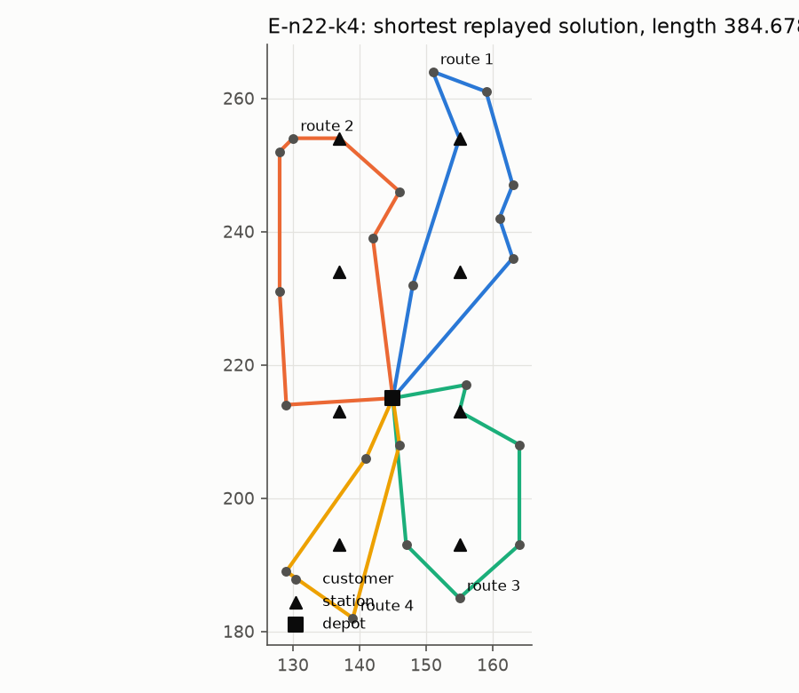
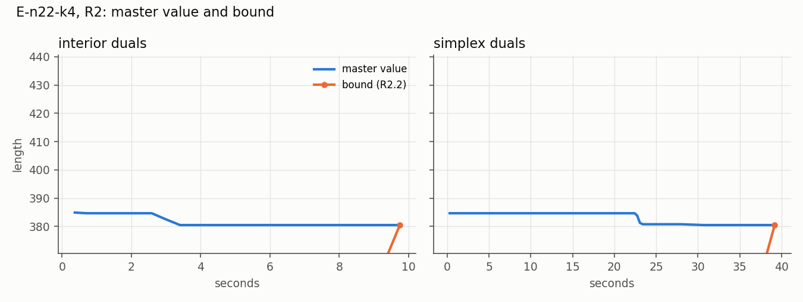
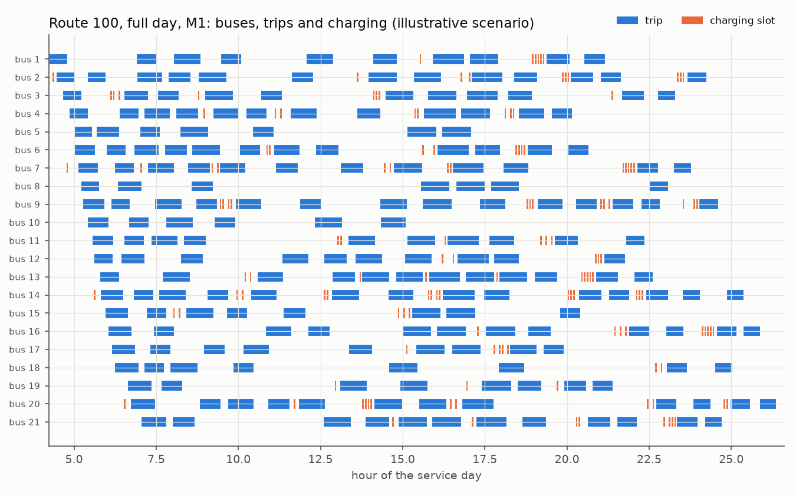
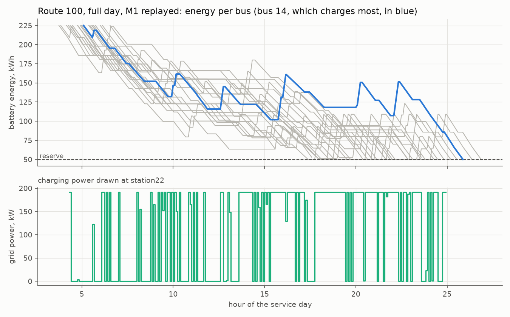

# Results

Regenerated by `python run_bench.py` from the bundles in this directory; each bundle records the revision, parameters and data checksums that produced it. Bundles written before 6b290be record the revision at completion rather than at start, and mark '+dirty' when any file differed, untracked bundles included.

## 2019 E instances (Validation §3, EVRP-06)

L is the best valid lower bound (R1 and R2 dual bounds, and the certified R0 value, since z(R0) <= z(R1)); U the shortest replayed solution (R1, R2's restricted master, GSGA). evrp-python's README values are not replayed. The last column counts segments of U's routes that pass two or more stations in a row (Routing §4).

| Instance | Report value | evrp-python (README) | GSGA replayed | R0 | L | U | Gap | Verdict | Multi-station segments |
|---|---:|---:|---:|---:|---:|---:|---:|---|---:|
| E-n22-k4 | 384.678035 | 384.67 | 384.678093 | 375.279787 | 380.500541 | 384.678093 | 1.086% | bracketed | 0 |
| E-n23-k3 | 573.130948 | 571.94 | 571.947383 | 568.562501 | 571.947383 | 571.947383 | 0.000% | certified optimal; report value not optimal | 0 |
| E-n30-k3 | 511.253921 | 509.47 | - | - | - | - | - | open | - |
| E-n33-k4 | 869.892175 | 840.14 | - | - | - | - | - | open | - |
| E-n51-k5 | 570.170703 | 529.90 | - | - | - | - | - | open | - |
| E-n76-k7 | 723.367517 | 692.64 | - | - | - | - | - | open | - |
| E-n101-k8 | 899.885589 | 839.29 | - | - | - | - | - | open | - |

## Interior versus simplex duals in R2 (CG-04)

| Instance | Iterations (IPM / simplex) | Pricing calls | Seconds | Bound (IPM / simplex) | Converged |
|---|---:|---:|---:|---:|---|
| E-n22-k4 | 14 / 67 | 16 / 72 | 9.8 / 39.3 | 380.5005 / 380.5005 | True / True |

## Route 100 (Validation §3, TRN-09)

Illustrative battery, charger and cost parameters (data/scenarios/route100.toml); costs in illustrative CAD for the modeled window. M0 minimizes the fleet without batteries; its duties are replayed with the battery and no charging, which gives their deadhead, their cost where feasible, and the number of buses that fall below the reserve. M1 values are replayed schedules.

| Window | Trips | M0 fleet | M0 deadhead km | M0 buses below reserve | M0 cost | M1 fleet | M1 deadhead km | M1 cost U | M1 L | Gap | M1 status |
|---|---:|---:|---:|---:|---:|---:|---:|---:|---:|---:|---|
| Route 100 to 08:00 | 54 | 16 | 337.4 | 0 | 7,046.57 | 16 | 337.4 | 7,046.57 | 7,046.56 | 0.000% | optimal |
| Route 100 to 10:00 | 77 | 16 | 358.7 | 0 | 7,123.65 | 16 | 358.7 | 7,123.65 | 7,062.86 | 0.853% | feasible_limit |
| Route 100, full day | 219 | 16 | 646.2 | 16 | - | 21 | 681.8 | 11,157.24 | 7,070.54 | 36.628% | feasible_limit |

## Figures

